<p align="center">
  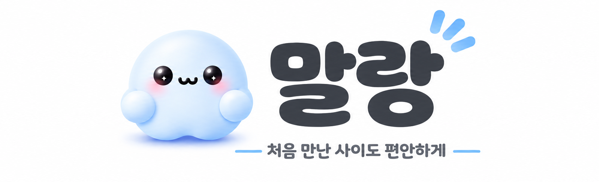
</p>

<h3 align="center">처음 만나서 어색한 우리, 말랑하게 알아가볼까요?</h3>

<p align="center">
  네트워킹 행사에서 조원들의 프로필을 모아 <b>AI가 우리 조만의 공통 대화 주제</b>를 만들어 주는 모바일 웹 아이스브레이커
</p>

<p align="center">
  <a href="https://huddling-1team.vercel.app"><b>🔗 라이브 데모</b></a> ·
  <a href="#화면">화면</a> ·
  <a href="#아키텍처">아키텍처</a> ·
  <a href="#ai-공통-주제-생성">AI 설계</a> ·
  <a href="#로컬-실행">로컬 실행</a>
</p>

<p align="center">
  
  
  
  
  
  
</p>

<p align="center">
  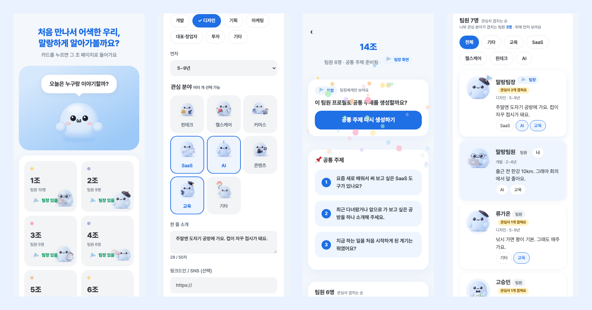
</p>

---

## 왜 만들었나

오프라인 밋업에서 처음 만난 사람들이 조로 모이면 첫 5분이 가장 어색합니다. 서로 무슨 일을 하는지, 어떤 얘기를 꺼내면 좋을지 모르기 때문입니다.

**말랑**은 이 5분을 줄입니다.

1. 참가자는 폰으로 자기 조를 고르고 30초짜리 프로필(직군 · 연차 · 관심 분야 · 한 줄 소개)을 씁니다.
2. 팀장은 버튼 하나로 **조원 프로필을 근거로 한 공통 대화 주제 3개**를 만듭니다.
3. 모두가 같은 주제와 서로의 프로필을 보며 바로 대화를 시작합니다. 나와 관심사가 겹치는 사람이 위에 먼저 보입니다.

로그인도, 앱 설치도, 초대 링크도 없습니다. 행사장에서 링크 하나로 들어와 바로 씁니다.

## 핵심 기능

| | 기능 | 설명 |
|---|---|---|
| 🧭 | **조 선택 → 역할 선택** | 1~15조 카드 중 내 조를 누르고 `팀원이에요` / `팀장이에요`를 고릅니다. 팀장은 조마다 한 명이며 먼저 잡는 사람이 팀장이 됩니다. |
| 🪪 | **30초 프로필** | 직군 · 연차 · 관심 분야(복수) · 50자 소개. 직군과 관심 분야마다 전용 캐릭터가 붙습니다. |
| 🤖 | **AI 공통 주제 3개** | 팀장만 보이는 버튼으로 생성합니다. 조원 프로필의 겹치는 관심사와 소개 속 일상 소재를 섞어 만들고, 언제든 다시 생성할 수 있습니다. |
| 📌 | **상단 고정 · 전원 공개** | 생성된 주제는 조 페이지 맨 위에 고정되어 조원 모두에게 3초 주기로 동기화됩니다. |
| 🤝 | **관심사 기반 정렬 · 필터** | 나와 관심 분야가 겹치는 팀원이 위로 올라오고 `관심사 2개 겹쳐요` 배지가 붙습니다. 분야 칩으로 걸러 볼 수 있습니다. |
| 🚩 | **팀장 · 팀원 구분** | 팀장은 깃발 배지와 테두리로 한눈에 구분됩니다. |
| 🛠 | **운영진 페이지** | 조별 인원 · 팀장 · 주제 현황을 보고, 팀장 해제와 프로필 삭제를 할 수 있습니다. |

## 화면

> 모든 캡처는 운영 서비스(390×844 모바일 뷰포트)에서 가상 데이터로 찍었습니다.

### 1. 조 고르기 → 역할 정하기

| 랜딩 · 조 목록 | 조 카드 | 역할 선택 |
|:---:|:---:|:---:|
| 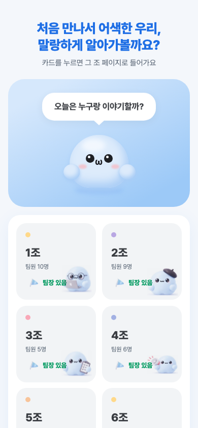 | 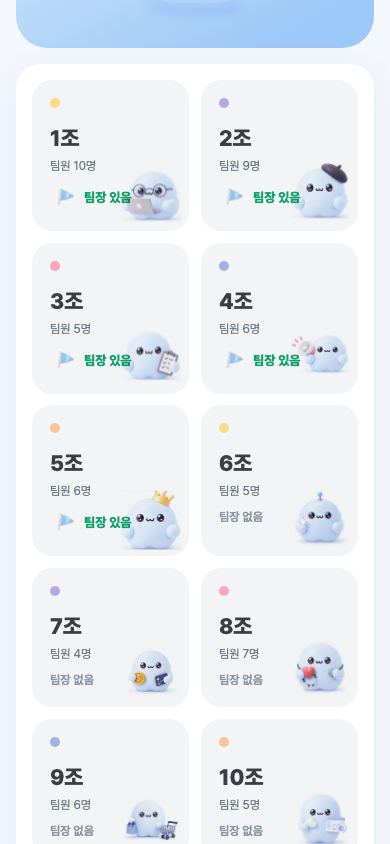 | 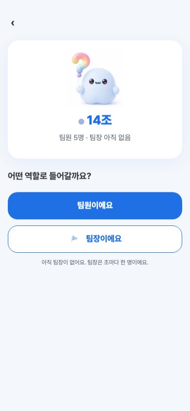 |

### 2. 프로필 작성

| 직군 캐릭터 미리보기 | 관심 분야 캐릭터 타일 | 합류 완료 |
|:---:|:---:|:---:|
| 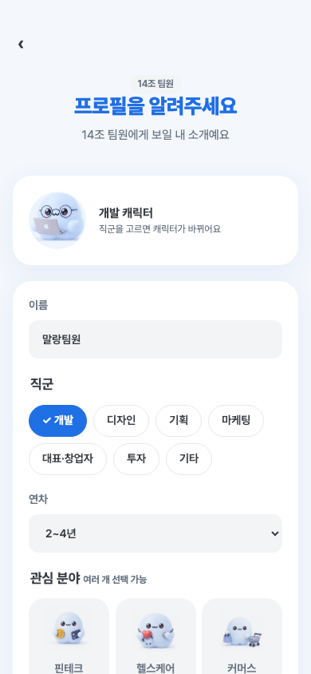 | 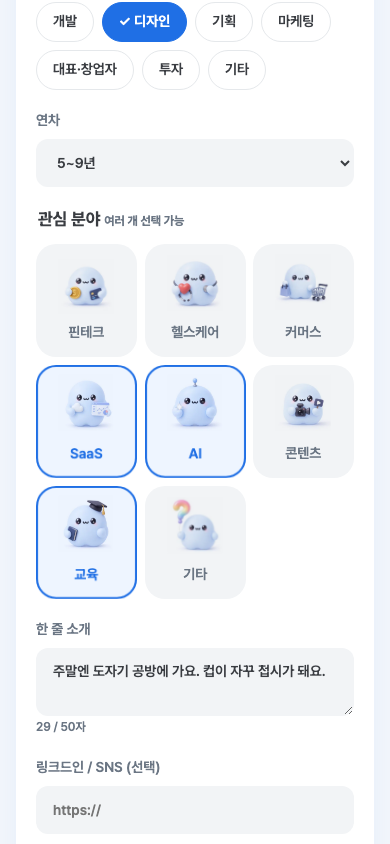 | 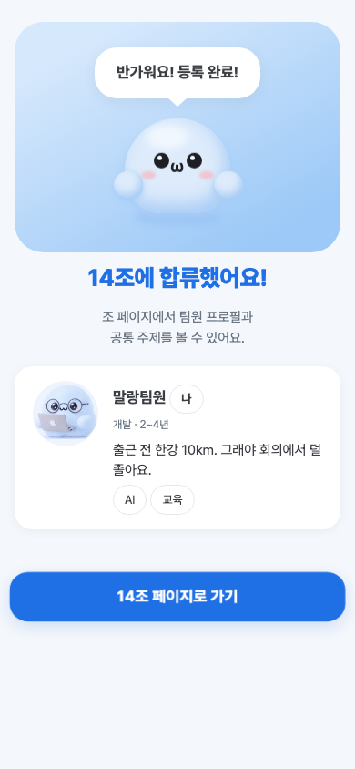 |

### 3. 팀장: AI 공통 주제 만들기

| 팀장 환영 | 생성 중 로딩 | 주제 완성 (파티클) |
|:---:|:---:|:---:|
| 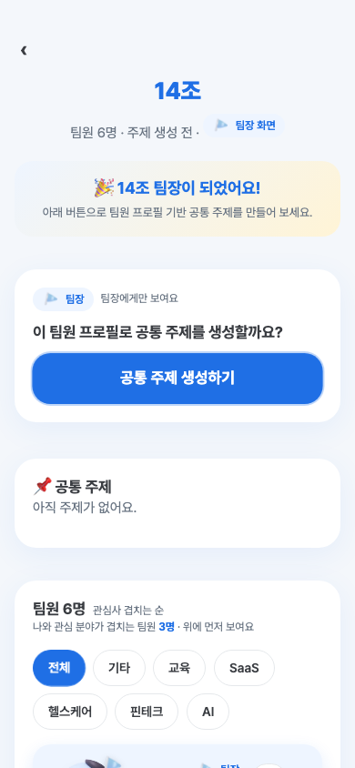 | 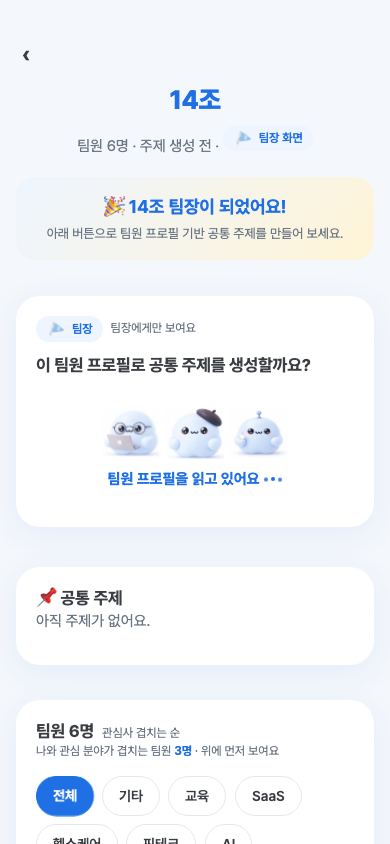 | 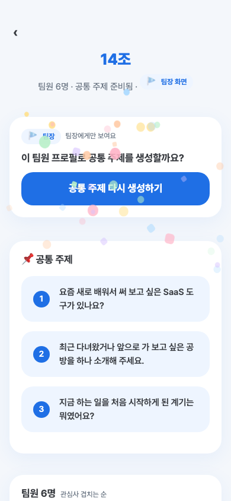 |

### 4. 팀원: 주제 보고, 겹치는 사람 찾기

| 공통 주제 | 관심사 겹치는 순 정렬 | 관심 분야 필터 |
|:---:|:---:|:---:|
| 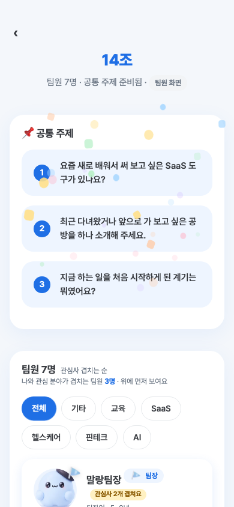 | 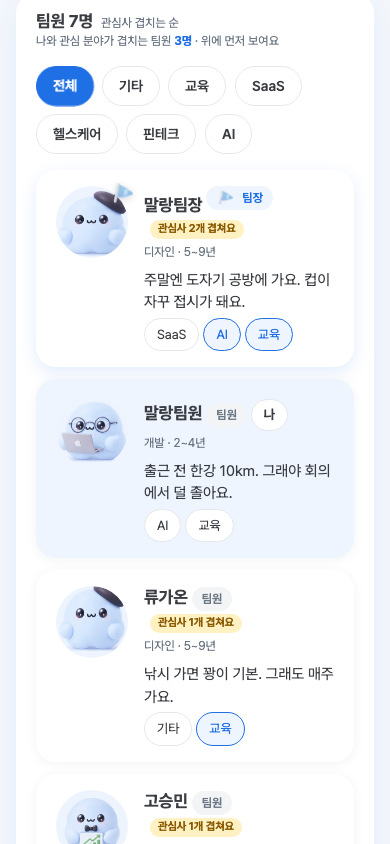 | 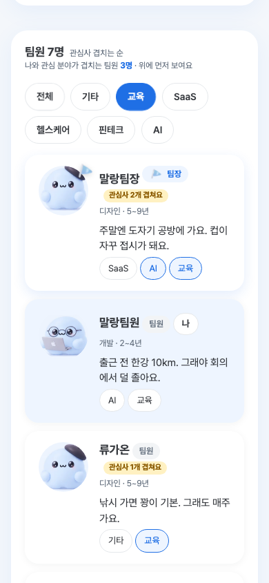 |

## 사용자 흐름

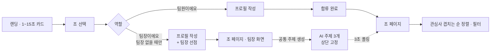

## 아키텍처

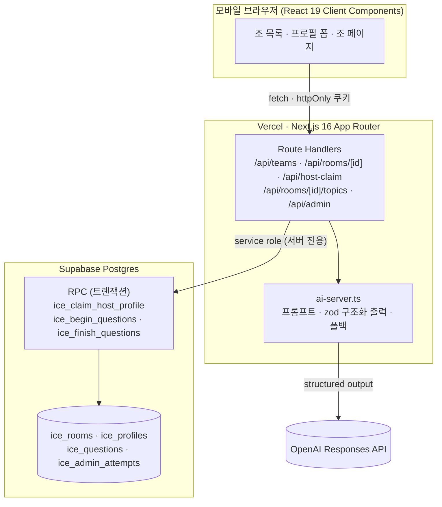

- **서버 전용 비밀값:** Supabase service role 키, OpenAI 키, 행사 토큰은 모두 서버 환경변수에만 있습니다. 클라이언트로 내려가는 값이 없습니다.
- **원자적 상태 변경:** 팀장 선점과 주제 저장은 Postgres RPC 안에서 `select … for update`로 처리합니다. 두 사람이 동시에 `팀장이에요`를 눌러도 한 명만 성공합니다.
- **실시간성:** 별도 소켓 없이 3초 폴링(`document.hidden`이면 쉼)으로 충분한 규모(조당 최대 30명)에 맞췄습니다.

## 데이터 모델

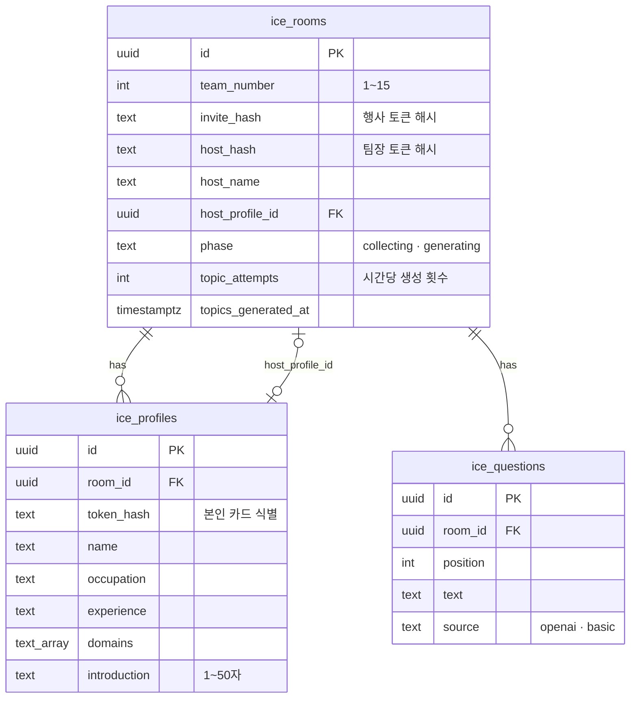

## AI 공통 주제 생성

`src/lib/ai-server.ts` · 모델 `gpt-6.1-terra` · reasoning effort `medium`

| 설계 포인트 | 구현 |
|---|---|
| **근거 있는 주제** | 조원들의 직군 · 연차 · 관심 분야 · 한 줄 소개를 JSON으로 넘기고, *3개 중 1개 이상은 여러 명이 겹치는 관심 분야*, *1개 이상은 소개 속 일상 소재*를 쓰게 합니다. 이름은 넣지 않습니다. |
| **매번 다른 주제** | 10개 소재 풀(업무 에피소드 · 도구 · 점심 · 퇴근 후 · 시작 계기 …)에서 3개를 무작위로 뽑아 질문마다 하나씩 배정합니다. 이전에 나온 주제(`previousTopics`)를 함께 넘겨 겹치지 않게 합니다. |
| **담백한 톤** | 1차 결과가 *"클라이밍 홀드가 커피 맛이라면?"*처럼 오글거린다는 피드백을 받고, 비유 · 의인화 · 억지 상상 · 감성 수식어를 금지하고 좋은 예/나쁜 예를 프롬프트에 넣었습니다. |
| **구조화 출력** | `zodTextFormat`으로 `{ questions: string[3] }`만 받아 검증합니다. 길이 · 개수가 틀리면 버립니다. |
| **안전한 실패** | 45초 타임아웃, 재시도 0회. 실패하거나 AI가 꺼져 있으면 관심사 기반 기본 주제 3개로 대체합니다. 화면이 비지 않습니다. |
| **비용 가드** | `AI_ENABLED`와 `AI_ALLOW_PAID`가 모두 `true`일 때만 유료 호출합니다. 조마다 시간당 10회로 제한합니다(RPC에서 검사). |
| **입력 격리** | 사용자 입력은 모두 데이터로만 다루고 그 안의 지시를 따르지 않게 합니다. 나이 · 연애 · 연봉 · 외모 · 정치 · 종교 질문을 금지합니다. |

<details>
<summary>프롬프트 개선 전후 예시</summary>

| 개선 전 | 개선 후 (운영) |
|---|---|
| 숏폼 한 편 더 보게 되는 밤, 나만의 작은 행복은 뭐예요? | 업무에 자주 쓰는 도구나 앱 중 동료에게 추천하고 싶은 건 뭐예요? |
| 만약 클라이밍 홀드가 커피 맛이라면, 어떤 맛부터 잡으실래요? | 지금 하는 일을 처음 시작하게 된 계기는 뭐였어요? |
| 콘텐츠·교육·AI 중 요즘 빠져 있는 주제를 간식에 비유하면요? | 요즘 새로 배워서 써 보고 싶은 SaaS 도구가 있나요? |

</details>

## 보안 · 운영 설계

- **로그인 없는 본인 식별:** 프로필 · 팀장 권한은 무작위 토큰을 `httpOnly · Secure · SameSite=Lax` 쿠키로 주고, DB에는 **SHA-256 해시만** 저장합니다.
- **행사 범위 고정:** 어떤 행사의 조인지는 서버 환경변수의 행사 토큰 해시로만 정합니다. 클라이언트가 보낸 값으로 다른 행사에 접근할 수 없습니다.
- **요청 출처 검사:** 쓰기 API는 `Origin`을 확인해 외부 사이트에서 보낸 요청(CSRF)을 막습니다.
- **RLS + 서버 전용 RPC:** 모든 테이블에 Row Level Security를 켜고, RPC는 `service_role`에만 실행 권한을 줍니다.
- **운영진 로그인 제한:** IP 해시 기준으로 실패 횟수를 세어 무차별 대입을 막습니다.
- **캐시 정책:** 조회 API는 `no-store`, 캐릭터 이미지는 파일명 버전 관리 + `max-age=1년, immutable`입니다.

## UI · 인터랙션

디자이너가 정리한 Figma 디자인 시스템을 파스텔 톤으로 맞추고, 시안 12개 화면을 구현했습니다.

- **말랑 캐릭터 15종:** 직군 7종 + 관심 분야 8종. 기존 캐릭터 스타일을 레퍼런스로 생성한 뒤 256px WebP로 줄여 **약 800KB → 60KB**가 되었습니다.
- **둥둥 · 말랑 모션:** 캐릭터는 떠 있다가 호버하면 젤리처럼 흔들리고, 버튼과 카드는 누르면 찌그러졌다 튕기는 스프링 효과가 있습니다.
- **연출:** 조 합류 · 조 페이지 진입 · 주제 완성 때 파스텔 파티클이 터집니다. 주제를 생성하는 동안에는 캐릭터 셋이 통통 뛰며 단계 문구가 바뀝니다.
- **접근성:** `prefers-reduced-motion`이면 모든 애니메이션과 파티클을 끕니다. 포커스 링, `aria-live` 로딩 상태, 장식 이미지의 `alt=""`를 지켰습니다.

## 기술 스택

| 영역 | 사용 |
|---|---|
| 프론트엔드 | Next.js 16 (App Router) · React 19 · TypeScript · CSS 변수 기반 디자인 토큰 |
| 백엔드 | Next.js Route Handlers · Supabase Postgres (RPC · RLS) |
| AI | OpenAI Responses API · zod 구조화 출력 |
| 배포 | Vercel (main 푸시 → 운영 자동 배포) |
| 테스트 | Vitest (API · 추천 로직 36개) |
| 디자인 | Figma 디자인 시스템 · Mobbin 레퍼런스 |

## 프로젝트 구조

```text
src/
├─ app/
│  ├─ page.tsx                 # 랜딩 · 1~15조 카드
│  ├─ room/[id]/{start,join,host}/  # 역할 선택 · 팀원/팀장 프로필
│  ├─ room/[id]/page.tsx       # 조 페이지 (주제 · 팀원 목록)
│  ├─ admin/                   # 운영진 페이지
│  └─ api/                     # teams · rooms · host-claim · topics · admin
├─ components/                 # room-view · join-form · generating · particles · mallang …
└─ lib/
   ├─ ai-server.ts             # 공통 주제 프롬프트 · 폴백
   ├─ characters.ts            # 직군 · 관심 분야 · 조별 캐릭터 매핑
   ├─ event-server.ts          # 행사 범위 · 본인 카드 조회
   └─ server.ts                # 토큰 해시 · 쿠키 · 출처 검사
supabase/migrations/           # 테이블 · RLS · RPC (번호 순서대로 적용)
public/chars/                  # 캐릭터 WebP 15종
docs/                          # 스크린샷 · API 상세
```

## 로컬 실행

```bash
cp .env.sample .env.local     # 값 채우기 (실제 키는 커밋하지 않음)
npm install
npm run dev                   # http://localhost:3000
npm test                      # Vitest
npm run typecheck
```

1. Supabase 새 프로젝트에 `supabase/migrations/*.sql`을 번호 순서대로 적용합니다.
2. `node scripts/setup-event.mjs --base-url http://localhost:3000`로 행사와 1~15조를 만듭니다. 행사 토큰은 `.env.local`에 저장됩니다.
3. AI 주제를 쓰려면 `OPENAI_API_KEY`, `OPENAI_MODEL`, `AI_ENABLED=true`, `AI_ALLOW_PAID=true`를 설정합니다. 설정하지 않으면 기본 주제로 동작합니다.

| 환경변수 | 용도 |
|---|---|
| `SUPABASE_URL` · `SUPABASE_SECRET_KEY` | 서버 전용 DB 접속 |
| `HUDDLING_EVENT_TOKEN` | 행사 범위를 정하는 토큰 (해시로 비교) |
| `ADMIN_ID` · `ADMIN_PASSWORD` | 운영진 로그인 |
| `OPENAI_API_KEY` · `OPENAI_MODEL` | 공통 주제 생성 |
| `AI_ENABLED` · `AI_ALLOW_PAID` | 유료 호출 이중 스위치 |
| `NEXT_PUBLIC_APP_URL` | 배포 주소 (비우면 요청 주소 사용) |

API 명세와 운영 메모는 [`docs/API.md`](docs/API.md)에 있습니다.

## 만든 과정

하루짜리 밋업 프로젝트입니다. 기획 · 디자인 · 개발을 동시에 진행했습니다.

### PRD → 흐름 단순화

초안의 흐름은 *초대 링크 → 투표*였습니다. 실제 행사 동선에 맞춰 *조 카드 → 역할 → 프로필 → 공통 주제*로 줄였습니다. 초대 링크와 투표를 없애 입장 단계를 두 번 줄였습니다.

### 디자인 → 코드

Figma 디자인 시스템(컬러 · 타이포 · 컴포넌트)을 CSS 토큰으로 옮겼습니다. 시안 12개 화면을 구현한 뒤 모션을 더했습니다.

### AI 에이전트 병렬 개발

백엔드 API, 프론트 화면, Figma 구현을 git worktree로 나눴습니다. 여러 코딩 에이전트가 이 작업을 동시에 진행했습니다. 감독 세션은 API 계약 문서를 기준으로 작업 사이의 연결을 맞췄고, 검수 · 머지 · 배포도 맡았습니다.

### 운영 피드백 반영

시연 리허설에서 주제 톤, 팀장 진입 버그, 이미지 로딩 속도, 팀장 표시 크기에 대한 피드백이 나왔습니다. 작은 단위로 고쳐 바로 운영에 배포했습니다.
